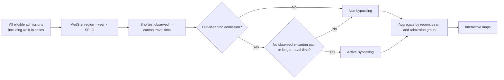

# Active Bypassing in Swiss Hospital Care

Interactive maps and methodological documentation for a revealed-choice measure of cross-canton hospital bypassing in Switzerland.

**Explore the maps:** [Elective admissions](docs/Map_Choropleth_Elective_Leaflet.html) · [Urgent admissions](docs/Map_Choropleth_Urgent_Leaflet.html)

## How Active Bypassing is measured

The measure uses a **revealed behavioral benchmark**, not a mechanically assigned nearest hospital. For every MedStat region *r*, year *t*, and detailed SPLG category *g*, it identifies the shortest observed travel time among patients who reside and are admitted in the same canton:

\[
m_{rtg}=\min_{j:R_j=r,\,T_j=t,\,G_j=g,\,H_j=K_j}d_j
\]

A patient *i* is an Active Bypasser when the patient is admitted outside the home canton and either no in-canton pathway is observed for the relevant cell or the realized journey is longer than the revealed in-canton benchmark:

\[
B_i=\mathbb{1}(H_i\ne K_i)\cdot\mathbb{1}[m_{R_iT_iG_i}\text{ is missing}\;\lor\;d_i>m_{R_iT_iG_i}]
\]

The reference benchmark includes all eligible admissions, including self-referral and walk-in cases. Self-referral cases are excluded only from the final urgent-admission analysis sample. Classification is performed at the detailed SPLG level; Basic Package (BP) and Non-BP categories are reporting aggregates in the maps.

## Data availability

The underlying BFS hospital microdata are confidential and are not distributed with this repository. This repository contains only interactive maps based on region-year aggregates, a simplified map-rendering template, and methodological documentation. It contains no patient-level records, source data, Excel workbooks, or intermediate analysis files.

## Repository contents

| Location | Contents |
| --- | --- |
| `docs/` | Interactive Leaflet maps and the GitHub Pages entry page |
| `code/` | Simplified, path-free template showing map rendering logic |
| `data/README.md` | Data-access and confidentiality statement |

## Citation

Please cite the repository version or release used in your work. A DOI will be added after the first archived release.
