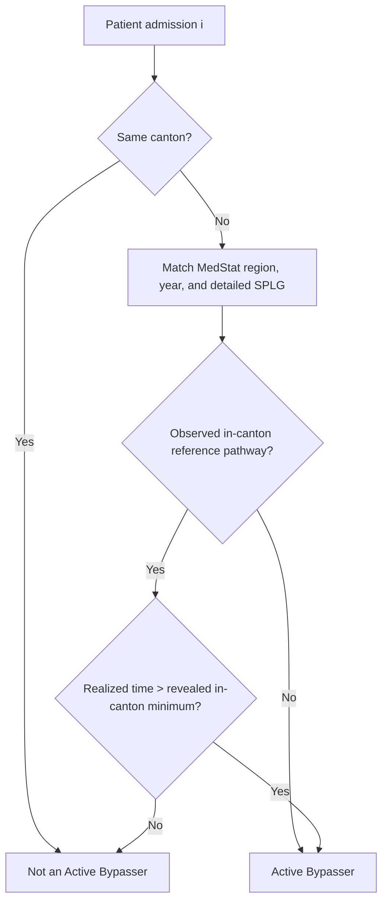

# Active Bypassing in Swiss Hospital Care

Interactive maps and methodological documentation for a revealed-choice measure of cross-canton hospital bypassing in Switzerland.

> **Open the interactive maps through GitHub Pages.** GitHub does not preview the source of large self-contained HTML files. This does **not** mean that a map is empty or missing.

| Admission group | Interactive map |
| --- | --- |
| Elective admissions | [Open the interactive map](https://fuenqi.github.io/patient-mobility-bypass-maps/Map_Choropleth_Elective_Leaflet.html) |
| Urgent admissions | [Open the interactive map](https://fuenqi.github.io/patient-mobility-bypass-maps/Map_Choropleth_Urgent_Leaflet.html) |

## Map previews

All previews show **2023**. Use the interactive maps above to select other years, zoom, and inspect MedStat-region pop-ups.

### Elective admissions

#### Full map (2023)

The colour scale shows the MedStat region’s **Active Bypassing rate**: pale yellow indicates a low rate (near 0%), while darker blue indicates a higher rate (up to 100%). In the interactive map, select a year with the controls in the upper-right corner, use **+ / −** to zoom, and click a MedStat region to open its case-count, rate, BP/Non-BP, and travel-time summary.

#### GR26 selected (2023)

This example shows that **332 of 638 elective admissions (52.0%)** in GR26 were classified as Active Bypassing in 2023. Among GR26’s elective **BP** cases, **7** were Active Bypass patients (**6.4%**; **110 BP cases** overall), with a mean travel time of **215.9 minutes**. Among **Non-BP** cases, **325** were Active Bypass patients (**61.6%**; **528 Non-BP cases** overall), with a mean travel time of **86.8 minutes**.

### Urgent admissions

#### Full map (2023)

The colour scale shows the MedStat region’s **Active Bypassing rate**: pale yellow indicates a low rate (near 0%), while darker blue indicates a higher rate (up to 100%). In the interactive map, select a year with the controls in the upper-right corner, use **+ / −** to zoom, and click a MedStat region to open its case-count, rate, BP/Non-BP, and travel-time summary.

#### GR26 selected (2023)

This example shows that **123 of 419 urgent admissions (29.4%)** in GR26 were classified as Active Bypassing in 2023. Among GR26’s urgent **BP** cases, **6** were Active Bypass patients (**2.3%**; **256 BP cases** overall), with a mean travel time of **195.4 minutes**. Among **Non-BP** cases, **117** were Active Bypass patients (**71.8%**; **163 Non-BP cases** overall), with a mean travel time of **65.3 minutes**.

## Method: a revealed-choice benchmark

The measure is not based on an external hospital directory or a purely geographic nearest-hospital rule. For each **MedStat region × year × detailed SPLG group**, it uses the observed in-canton choices of comparable patients to reveal the contemporaneously feasible in-canton pathway.

Walk-in/self-referral observations remain in the comparison set when this benchmark is constructed. The elective/urgent distinction is applied for reporting and map presentation; supply is defined at the hospital–SPLG level rather than by admission channel.

For region \(r\), year \(t\), and detailed SPLG group \(g\), let \(d_j\) denote the realized travel time of patient \(j\), \(H_j\) the treating-hospital canton, and \(K_j\) the home canton. The revealed in-canton benchmark is:

$$
m_{rtg}=\min_{j:R_j=r,\,T_j=t,\,G_j=g,\,H_j=K_j} d_j.
$$

A patient \(i\) is classified as an Active Bypasser when the admission is outside the home canton and either no in-canton pathway is observed for the relevant cell or the realized journey is strictly longer than the revealed benchmark:

$$
B_i=\mathbb{1}(H_i\ne K_i)\cdot\mathbb{1}\left[m_{R_iT_iG_i}\text{ is missing }\;\lor\; d_i>m_{R_iT_iG_i}\right].
$$

The maps aggregate the resulting indicator by MedStat region and year:

$$
\text{Bypass Rate}_{rt}=\frac{\sum_{i\in(r,t)} B_i}{N_{rt}},\qquad N_{rt}=\left|\{i\in(r,t)\}\right|.
$$

BP and Non-BP values shown in a pop-up are communication summaries only; the underlying comparison is made at detailed SPLG level.

## Repository contents

- docs/ — two self-contained interactive Leaflet maps and the GitHub Pages entry point.
- code/render_leaflet_maps.R — a path-free illustrative rendering template; it does not expose data locations or data-processing entry points.
- data/README.md — data-access and confidentiality statement.

## Data availability and confidentiality

No patient-level data, hospital-level source data, Excel workbooks, geographic source layers, access credentials, or restricted data paths are included in this repository. The interactive maps contain only published visual outputs and aggregated regional statistics. Reproduction using the underlying data requires the appropriate authorized data access.

## Citation

Please cite the associated paper and this repository's GitHub Pages maps when referring to the interactive visualizations.
